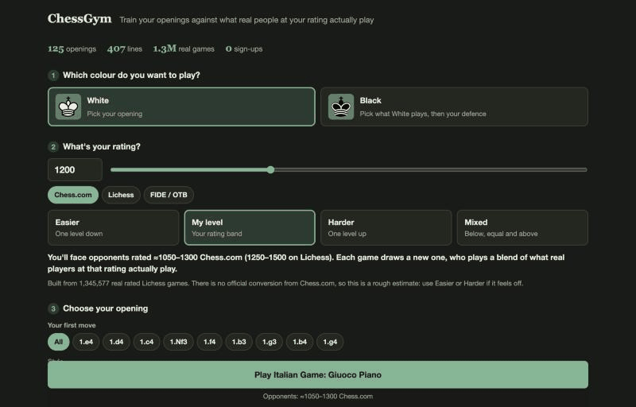

<div align="center">

# ChessGym

### Stop practising openings against a script.<br>Practise against what real people at your rating actually play.

**[Play now, free, no sign-up](https://aduhax16.github.io/ChessGym/)**

[](https://aduhax16.github.io/ChessGym/)
[](data/openings.json)
[](#where-the-moves-come-from)
[](LICENSE)

<a href="https://aduhax16.github.io/ChessGym/#fried-liver"></a>

</div>

## The problem with opening trainers

Most trainers quiz you on grandmaster theory. Then you sit down for a real game, your 1200-rated opponent plays something no book mentions, and you're on your own by move 4.

ChessGym's opponent chooses each move using the frequencies from **1.3 million real rated games**, at your level. So you meet the replies you'll actually meet, including the bad ones you should know how to punish.

## How different are the levels? Very.

Everyone has heard of the Fried Liver Attack. After `1.e4 e5 2.Nf3 Nc6 3.Bc4 Nf6 4.Ng5 d5 5.exd5`, the natural recapture `5...Nxd5` walks into it. Here is who still plays it:

| Rating (Lichess) | Play `5...Nxd5` | White's win rate after it |
| --- | --- | --- |
| 750–1000 | **76%** | 63% |
| 1000–1250 | **71%** | 65% |
| 1250–1500 | **53%** | 63% |
| 1500–1750 | 33% | 65% |
| 1750–2000 | 17% | 62% |
| 2000–2250 | 8% | 47% |
| 2250–2500 | 2% | too few games |

The same pattern shows up everywhere:

- **Replies to 1.e4:** at 1000–1250, 63% answer `1...e5` and only 7% play the Sicilian. At 2250–2500 it flips: 20% `1...e5`, 36% Sicilian.
- **The Scholar's Mate attempt:** after `1.e4 e5`, 12% of players under 750 bring out `2.Qh5`. At 1500–1750 it's down to 1%.

If you learn only what the masters play, you're preparing for someone else's games.

**[Try the Fried Liver →](https://aduhax16.github.io/ChessGym/#fried-liver)**

## What you get

- **125 openings and 407 lines**, from the Italian to the Grob.
- **Free play.** No script: play any opening and see how people at your rating respond. When the real games run out, a simple bot finishes the game.
- **Play either colour.** With Black, choose what White opens with and then your defence.
- **Opponents matched to you.** Enter your Chess.com, Lichess or FIDE rating and you get a 250-point band. Each game draws a new opponent inside it, who plays a blend of the two nearest levels. You can also ask for easier, harder or mixed.
- **Learn and Practice modes.** Follow the arrows first, then play from memory.
- **Real progress.** Right answers build mastery, misses take a little back, and the lines you haven't mastered come up more often.
- **Real stats after every move:** how often each move is played at your level, and how it scores.
- **Arrows and marks.** Right-click a square to mark it and right-drag to draw an arrow, as on Chess.com. Hold Shift or Alt to change the colour.
- **Your board, your colours.** Choose a theme or pick your own colours, in light or dark mode.
- **Install it like an app.** Add it to your phone or Mac from the Install button. It gets its own icon and works offline.
- **No account, no ads, no tracking.** Your progress stays on your device.

## Pick your poison

| Mood | Try |
| --- | --- |
| I want to attack | [Fried Liver](https://aduhax16.github.io/ChessGym/#fried-liver) · [Evans Gambit](https://aduhax16.github.io/ChessGym/#evans-gambit) · [King's Gambit](https://aduhax16.github.io/ChessGym/#kings-gambit) · [Smith-Morra](https://aduhax16.github.io/ChessGym/#smith-morra) |
| I want dirty tricks | [Stafford](https://aduhax16.github.io/ChessGym/#stafford) · [Englund](https://aduhax16.github.io/ChessGym/#englund) · [Albin](https://aduhax16.github.io/ChessGym/#albin) · [From's Gambit](https://aduhax16.github.io/ChessGym/#from-gambit) |
| I want something solid | [London](https://aduhax16.github.io/ChessGym/#london) · [Caro-Kann](https://aduhax16.github.io/ChessGym/#caro-kann) · [Slav](https://aduhax16.github.io/ChessGym/#slav) · [Berlin](https://aduhax16.github.io/ChessGym/#berlin) |
| I want to play like the world champions | [Najdorf](https://aduhax16.github.io/ChessGym/#najdorf) · [Catalan](https://aduhax16.github.io/ChessGym/#catalan) · [Grünfeld](https://aduhax16.github.io/ChessGym/#grunfeld) · [Marshall](https://aduhax16.github.io/ChessGym/#marshall) |
| I want chaos | [Grob](https://aduhax16.github.io/ChessGym/#grob) · [Latvian](https://aduhax16.github.io/ChessGym/#latvian) · [Caro-Kann Fantasy](https://aduhax16.github.io/ChessGym/#caro-fantasy) · [Polish](https://aduhax16.github.io/ChessGym/#polish) |

<details>
<summary><b>See every opening</b></summary>

**With White**

- **1.e4 e5:** Italian Game, Evans Gambit, Fried Liver, Two Knights with d3, Ruy Lopez, Ruy Lopez Exchange, Scotch, Scotch Gambit, Four Knights, Ponziani, Vienna, King's Gambit, Bishop's Opening, Danish Gambit, Center Game, and how to beat the Petrov, Stafford, Philidor, Latvian and Elephant
- **Against the Sicilian:** Open Sicilian, Alapin, Smith-Morra, Grand Prix, Closed Sicilian, Rossolimo and Moscow
- **Against other 1.e4 defences:** Caro-Kann (Advance, Exchange, Fantasy), French (Advance, Tarrasch), Scandinavian, Alekhine, Pirc Austrian Attack, Modern
- **1.d4:** Queen's Gambit, Catalan, London, Jobava London, Trompowsky, Torre, Colle-Zukertort, Stonewall Attack, Richter-Veresov, Blackmar-Diemer, Staunton Gambit, and how to beat the Nimzo-Indian, King's Indian, Grünfeld, Benoni, Benko, Dutch and Englund
- **Flank openings:** Réti, King's Indian Attack, English, Bird, Larsen, Polish, Benko's Opening, Grob

**With Black**

- **Against 1.e4, the Sicilian:** Najdorf, Dragon, Accelerated Dragon, Sveshnikov, Taimanov, Kan, Classical, Scheveningen, Anti-Sicilians
- **Against 1.e4, other defences:** Caro-Kann, French, Scandinavian, Portuguese Gambit, Alekhine, Pirc, Modern, Owen's, Nimzowitsch
- **Against 1.e4 with 1...e5:** Italian, Two Knights, Ruy Lopez, Berlin, Marshall, Schliemann, Scotch, Vienna, King's Gambit Accepted, Falkbeer, Petrov, Stafford, Philidor, Latvian, Elephant
- **Against 1.d4:** King's Indian, Nimzo-Indian, Queen's Indian, Bogo-Indian, Grünfeld, Queen's Gambit Declined and Accepted, Slav, Semi-Slav, Tarrasch, Dutch (Leningrad, Stonewall), Benoni, Benko, Budapest, Albin, Englund, Chigorin, Old Indian, and systems such as the London
- **Against anything else:** answers to 1.c4, 1.Nf3, 1.f4, 1.b3, 1.g3, 1.b4 and 1.g4

</details>

## Where the moves come from

- **Opponent moves:** a sample of 1,345,577 rated blitz, rapid and classical games from the [Lichess open database](https://database.lichess.org/) (January 2024, CC0). Each move counts in the band of the player who made it.
- **Your repertoire:** a curated set of lines, **checked with Stockfish 19**. About 2,000 student moves went through the audit, and anything that lost too much was fixed. Gambits get more leeway, and the few deliberately unsound trap lines tell you they're traps.
- **After your repertoire ends:** moves commonly chosen by players rated 2000+.
- **Free play:** real moves at your level, then from nearby levels. Past that, a small built-in bot takes over. It is not calibrated to your rating and tops out at club strength.

### Honest limitations

- Ratings are Lichess ratings. There is no official conversion, so the Chess.com and FIDE options are rough estimates. Use Easier or Harder if a level feels off.
- Rare positions have too few games to use, so a line can end early when your opponent wanders far from known paths.
- The audit covers your moves at a fixed engine depth. It doesn't prove a line is the best one, and no engine checks the written explanations, so corrections from strong players are very welcome.

## Run it yourself

No build step and no dependencies to install:

```bash
git clone https://github.com/Aduhax16/ChessGym.git
```

```bash
cd ChessGym && python3 -m http.server 8000
```

Then open <http://localhost:8000>. Tests run at <http://localhost:8000/tests/>.

## Contribute

Your favourite line is missing? Adding one means editing a JSON file, with no JavaScript needed. See [CONTRIBUTING.md](CONTRIBUTING.md).

Ideas on the list:

- [ ] Stockfish in the browser, for a stronger free-play opponent and positions beyond the data
- [ ] Spaced repetition for the lines you miss
- [ ] Import your own repertoire from a PGN or a Lichess study
- [ ] More languages

## Licence

The code is [MIT](LICENSE). Game data is CC0, from Lichess. [chess.js](https://github.com/jhlywa/chess.js) is BSD-2-Clause. The pieces in `assets/pieces.svg` are by Cburnett and Rfc1394 on Wikimedia Commons, adapted by [cm-chessboard](https://github.com/shaack/cm-chessboard), under [CC BY-SA 3.0](https://creativecommons.org/licenses/by-sa/3.0/).

---

<div align="center">

**If ChessGym wins you a game, [leave a star](https://github.com/Aduhax16/ChessGym) so other players can find it.**

</div>
